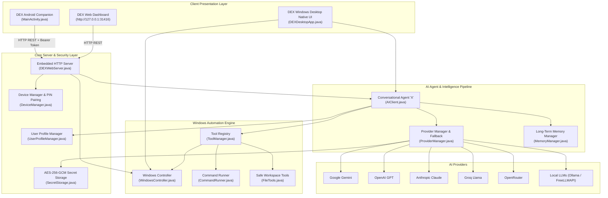

<div align="center">

# ⚡ DEX — Personal AI Assistant for Windows & Android Companion

**A privacy-focused, multi-provider AI desktop assistant and mobile companion built for Windows 10/11.**

[](assets/DEX-Setup.exe)
[](assets/DEX-Mobile.apk)
[](#-verified-test-suite--artifact-verification)
[](#-verified-test-suite--artifact-verification)
[](LICENSE)
[]()

[Features](#-key-features) • [Architecture](#-architecture) • [Design System](#-design-system) • [Installation](#-installation) • [Mobile Pairing](#-mobile-companion-pairing) • [Build from Source](#-building-from-source) • [API Setup](#-ai-provider-setup) • [Security](#-security--privacy-architecture) • [Troubleshooting](#-troubleshooting)

---

</div>

## 📖 Overview

**DEX** is a high-performance, extensible desktop AI companion designed specifically for **Windows 10 and Windows 11**, accompanied by an **Android Companion App** and a local **Web Dashboard**.

At its core, DEX pairs your local machine with an intelligent assistant named **X**, offering:
- **Intelligent multi-provider AI reasoning** (Google Gemini, OpenAI GPT, Anthropic Claude, Groq Llama, OpenRouter, local FreeLLMAPI, and local Ollama) with automatic fallback.
- **Deep Windows desktop automation** to launch applications, navigate media, manipulate files in an isolated workspace, and inspect open windows.
- **Screen vision & desktop analysis** powered by multimodal vision models.
- **Voice interaction & speech synthesis** on both desktop and mobile.
- **Local-first security** where sensitive API keys and secrets are encrypted on-disk with **AES-256-GCM** and never transmitted to client devices or stored in plaintext.

---

## 🎨 Design System

Both the Windows Desktop application and Android Companion interface adhere to a bespoke, minimalist aesthetic inspired by modern editorial design:

- **Warm Cream & Ivory Palette:** Soft, distraction-free backgrounds (`#FAF4EE` / `#FAF7F2`) reduce eye strain and replace harsh stark-white or high-contrast neon themes.
- **Burgundy & Wine Accents:** Deep luxury maroon (`#671A29`) accents for interactive pills, buttons, and focused navigation states.
- **Card-Based Hierarchy:** Clean, elevated white cards (`#FFFDFB`) with subtle warm borders (`#EFE4DA`) and rounded geometry (12px–16px).
- **Minimalist Navigation:** Clean sidebar navigation on desktop (Home, Chat, Voice, Vision, Files, Tools, Settings) and a 4-tab bottom dock on mobile (Home, Chat, Explore, Settings).
- **Clutter-Free Typography:** Clean sans-serif and serif pairings (Inter / Segoe UI / Georgia) with formatted typography. Markdown headers, code spans, and lists render cleanly without raw symbols or unformatted JSON blocks.

---

## ✨ Key Features

### 1. Multi-Provider AI Inference & Dynamic Fallback
- **Universal Provider Support:** Connect to Google Gemini (`v1beta`), OpenAI GPT (`/v1`), Anthropic Claude (`/v1`), Groq Llama, OpenRouter, local FreeLLMAPI (`http://127.0.0.1:31415/v1`), or local Ollama (`http://127.0.0.1:11434/v1`).
- **Resilient Fallback Routing:** Configure a secondary fallback provider. If your primary provider experiences rate limits, network timeouts, or server downtime, DEX automatically retries inference through the fallback provider with zero conversational interruption.
- **Iterative Tool Calling:** Automatically executes tool invocations in a loop before returning the verified result to the user.

### 2. Windows Desktop Automation & Tool Manager
- **Application Launcher:** Launch any installed Windows application or game via shell execution, protocol handlers, and AppIDs (e.g., VS Code, Google Chrome, WhatsApp, Steam, Discord, Spotify, Notepad, Calculator, Windows Settings, and File Explorer).
- **Direct File & Coding Workflows:** Tell DEX to create a project or script and open it in VS Code (e.g. *"open VS Code and write a program in C"*). DEX writes the code directly to disk and opens VS Code targeted to the new file.
- **Safe Command Runner:** Executes system queries and commands with execution timeouts, output character bounds (10,000 characters), and active output stream draining.
- **Media & Music Playback:** Plays requested tracks on YouTube or Spotify directly via default browser and shell execution.
- **Sanitized URL Navigation:** Safe URL parsing with character validation preventing command injection while safely handling query parameters (e.g. `&t=42s`).

### 3. Screen Vision & Multimodal Desktop Analysis
- **Screen Capture:** Captures the full Windows desktop screen and active windows via Java AWT Robot.
- **Visual Inspection:** Transmits screenshots directly to multimodal AI models (e.g., Gemini 1.5 Flash, GPT-4o Mini) to answer questions about active workspace documents, code on screen, or error messages.
- **Image Generation Disabled:** Image creation tools are deliberately omitted per project specification, focusing DEX strictly on productivity, vision analysis, and desktop automation.

### 4. Personal Profile & Assistant Identity "X"
- **Assistant Identity:** The conversational AI is named **X**. Queries like *"What is your name?"* or *"Who are you?"* reliably respond with identity **X**.
- **Personalized Onboarding:** First-time launch presents an onboarding modal across desktop, console CLI, mobile, and web dashboard, allowing the user to configure their preferred name.
- **Isolated User Profile:** User details are saved to `data/user_profile.json`, separate from conversation memory. Users can update their name or reset their profile at any time in Settings.

### 5. Voice Interaction & Speech Synthesis
- **Desktop Voice:** Interactive pulsing voice orb with waveform visualization and speech synthesis.
- **Android Speech-to-Text:** Live voice recognition powered by Android `SpeechRecognizer` with real-time waveform pulse animations and an active listening banner.
- **Android Text-to-Speech:** Android `TextToSpeech` engine configured with conversational pacing. Includes intelligent speech cleanup (`cleanTextForSpeech`) that filters raw markdown, code blocks, and URLs so DEX reads natural summaries aloud.
- **Top-Bar Voice Toggle & On-Demand Bubble Audio:** Instant speaker toggle on the chat bar and on-demand speaker buttons on individual assistant bubbles.

### 6. Long-Term Persistent Memory
- **Persistent Storage:** Session turns and extracted user facts are stored on-disk in `data/memory.json`.
- **Context Injection:** Saved user preferences and facts are injected into subsequent system prompts.
- **Non-Destructive Chat Clearing:** Typing `"clear chat"` resets the current conversational context while preserving persistent user facts. Memory files can be fully reset with explicit confirmation.

### 7. Secure Android Companion & Remote Access
- **Local Discovery & Auto-IP:** Automatic detection of Wi-Fi LAN IPv4 addresses, Ethernet, and Tailscale VPN IPs.
- **6-Digit Rolling PIN Pairing:** Devices pair with a cryptographically generated, time-limited PIN handshake.
- **Zero Secrets on Mobile:** API keys remain strictly on the Windows host machine; the Android companion stores zero provider keys.
- **Tailscale & WireGuard Ready:** Secure remote access outside home Wi-Fi without port forwarding.

---

## 🏗️ Architecture



---

## 📋 System Requirements & Prerequisites

| Component | Requirements |
| :--- | :--- |
| **Operating System** | Windows 10 (64-bit) or Windows 11 (64-bit) |
| **Windows Runtime** | `assets/DEX-Setup.exe` bundles its own self-contained Java runtime; no external Java installation required. |
| **Building Desktop from Source** | JDK 17 or higher (tested on JDK 17, 21, and 27) + Apache Maven 3.8+ |
| **Building Installer (.exe)** | [WiX Toolset 3.14](https://wixtoolset.org/releases/) (for MSI/EXE package generation via `jpackage`) |
| **Android Companion Device** | Android 8.0 (Oreo / API 26) through Android 14+ (API 34) |
| **Building Android from Source** | Android SDK Platform 34 + Android Build Tools 34.0.0 + JDK 17 |

---

## 📥 Installation

### Option 1: Windows Setup Wizard (Recommended)
1. Locate or download [`assets/DEX-Setup.exe`](assets/DEX-Setup.exe) (52.6 MB).
2. Double-click `DEX-Setup.exe` to launch the installation wizard.
3. Follow the on-screen prompts:
   - Default directory: `%LOCALAPPDATA%\DEX`
   - Automatically registers Start Menu and Desktop shortcuts.
   - Includes its own dedicated Java runtime environment.
4. Launch **DEX** from your Desktop or Start Menu.
5. To uninstall: open **Windows Settings > Apps > Installed apps > DEX > Uninstall**.

### Option 2: Standalone Portable Launcher
- Run [`assets/DEX.exe`](assets/DEX.exe) (167 KB) directly from the workspace root.
- Automatically resolves the local JRE and packaged JAR without requiring installation.

### Option 3: Android Companion App
1. Transfer [`assets/DEX-Mobile.apk`](assets/DEX-Mobile.apk) (6.2 MB) to your phone (via USB, cloud storage, or local transfer).
2. Open your device's file manager and tap `DEX-Mobile.apk`.
3. If prompted, enable **Allow from this source** in Android Settings.
4. Tap **Install**, then tap **Open**.

---

## 🔗 Mobile Companion Pairing

To pair your Android smartphone with your DEX desktop assistant:

1. **On your Windows PC:**
   - Launch DEX.
   - Go to the **Mobile Companion** tab (or check the Web Dashboard at `http://127.0.0.1:31416`).
   - Note your PC's IP address (e.g. `192.168.1.35` for Wi-Fi LAN, or `100.x.x.x` for Tailscale).
   - Click **`Generate New Pairing PIN`**. A 6-digit PIN will appear (valid for 5 minutes).

2. **On your Android Phone:**
   - Open the **DEX** app and navigate to **Settings**.
   - Enter your PC's **Host IP** and the **6-digit PIN**.
   - Tap **`Pair with Desktop`**.

3. **Verification:**
   - Status badge turns green (**ONLINE**).
   - Phone appears in the PC's **Active Paired Devices** table.
   - You can now chat with X, send voice queries, launch PC applications, and analyze screens remotely.

> [!TIP]
> **Remote Access Outside Home Wi-Fi:**
> Install [Tailscale](https://tailscale.com) on both your Windows PC and your Android phone. Enter the PC's 100.x.y.z Tailscale IP in the phone app to securely access DEX anywhere over an end-to-end encrypted WireGuard mesh.

---

## 🛠️ Building from Source

### 1. Build Everything (Windows + Android)
Run the master packaging script from PowerShell:
```powershell
powershell -ExecutionPolicy Bypass -File scripts\build_all.ps1
```

### 2. Build Windows Packages Only
```powershell
# Compiles Maven, packages standalone app-image, builds DEX-Setup.exe installer, and compiles DEX.exe launcher
powershell -ExecutionPolicy Bypass -File scripts\build_windows.ps1
```

### 3. Build Android Companion APK Only
```powershell
# Validates SDK, runs unit tests, and builds assets/DEX-Mobile.apk
powershell -ExecutionPolicy Bypass -File scripts\build_android.ps1
```

### 4. Running Unit Tests Directly
```powershell
# Desktop Suite (113 unit tests)
mvn test

# Android Suite (Unit tests)
cd mobile
.\gradlew.bat test
```

---

## 🧪 Verified Test Suite & Artifact Verification

All features, providers, security mechanisms, and build scripts are confirmed by actual unit test runs and package validations:

### Desktop Unit Test Suite (`mvn test`)
- **Total Tests:** **113 tests passed (0 failures, 0 errors, 0 skipped)**
- **Test Coverage Breakdown:**
  - `AIClientTest` (9 tests): Multi-provider routing, tool loop interception, image generation rejection, identity X verification, memory injection.
  - `WindowsControllerTest` (21 tests): Application resolution, VS Code file target launching, notepad launching, safe URL navigation with `&` escaping, music query playback.
  - `TaskManagerTest` (12 tests): Multi-step workflow parsing, task cancellation, process execution.
  - `DEXWebServerTest` (8 tests): `/api/status`, `/api/chat`, `/api/providers`, `/api/profile`, `/api/pair`, token verification.
  - `UserProfileManagerTest` (6 tests): First-launch status, user name updates, display formatting, profile reset, isolation.
  - `MemoryManagerTest` (7 tests): Long-term memory serialization, fact persistence, conversational history.
  - `ToolManagerTest` (8 tests): Tool registration, argument parsing, tool catalog generation.
  - `CommandRunnerTest` (5 tests): Safe command execution, process timeout, stream draining.
  - `FileToolsTest` (7 tests): Isolated workspace creation, file read/write, path normalization.
  - `DeviceManagerTest` (5 tests): Rolling PIN generation, expiration, device authentication tokens.
  - `SecretStorageTest` (3 tests): AES-256-GCM key derivation, encrypted persistence, key masking.
  - `BrowserAutomationTest` (2 tests): Headless navigation, query parsing.
  - `DEXConfigTest` (5 tests): Network interface detection, environment variable precedence.
  - `ProviderManagerTest` (6 tests): Provider registration, dynamic fallback, environment override, API request formation.
  - `OpenAICompatibleProviderTest` (5 tests): OpenAI-compatible payload serialization, vision payloads, headers, endpoint formatting.
  - `ProgramGeneratorTest` (4 tests): Multi-language program generation (Python, C, Java, HTML), VS Code integration.

### Android Test Suite (`gradlew test`)
- **Tasks Executed:** **44 tasks completed successfully with 0 errors**.
- **Coverage:** Configuration parsing, companion preferences, TTS string cleansing, and connection handling.

### Distribution Artifacts Verification

| Artifact | Location | Size | SHA256 Checksum |
| :--- | :--- | :--- | :--- |
| **DEX Installer** | [`assets/DEX-Setup.exe`](assets/DEX-Setup.exe) | 52.64 MB | `3815A1EA5C67A560FA6554C1E3FD9785D1613592683E66AF3C6CF9EED5D24D58` |
| **Standalone Launcher** | [`assets/DEX.exe`](assets/DEX.exe) | 0.16 MB | `49736E02532D67B76AF5821A3F143E482BD71D48D7FB206B6D95B0971E6C7583` |
| **Android Companion** | [`assets/DEX-Mobile.apk`](assets/DEX-Mobile.apk) | 6.18 MB | `63176B38CB1B800CBB342194E1ACCB2448389739C08D23AE695128CA48EFB014` |
| **Checksum Manifest** | [`assets/checksums.txt`](assets/checksums.txt) | 443 bytes | Validated SHA256 integrity manifest |

---

## ⚙️ AI Provider Setup

You can configure your active provider and API credentials through the **Desktop Settings UI**, the **Web Dashboard**, or environment variables:

| Provider | Environment Variable | Default Base URL | Default Model |
| :--- | :--- | :--- | :--- |
| **Google Gemini** | `GEMINI_API_KEY` | `https://generativelanguage.googleapis.com` | `gemini-1.5-flash` |
| **OpenAI GPT** | `OPENAI_API_KEY` | `https://api.openai.com/v1` | `gpt-4o-mini` |
| **Anthropic Claude** | `ANTHROPIC_API_KEY` | `https://api.anthropic.com/v1` | `claude-3-5-sonnet-20241022` |
| **Groq Llama** | `GROQ_API_KEY` | `https://api.groq.com/openai/v1` | `llama-3.3-70b-versatile` |
| **OpenRouter** | `OPENROUTER_API_KEY` | `https://openrouter.ai/api/v1` | `auto` |
| **FreeLLMAPI (Local)** | `DEX_API_KEY` *(optional)* | `http://127.0.0.1:31415/v1` | `auto` |
| **Ollama (Local)** | *(None required)* | `http://127.0.0.1:11434/v1` | `llama3` |

### Setting Environment Variables via PowerShell:
```powershell
$env:GEMINI_API_KEY = "AIzaSy..."
$env:DEX_AI_PROVIDER = "gemini"     # options: gemini, openai, claude, groq, openrouter, freellmapi, ollama
```

---

## 🔒 Security & Privacy Architecture

DEX is built around strict, local-first privacy principles:

1. **AES-256-GCM Encryption:** All API keys and secrets stored locally in `data/secrets.enc` are encrypted using AES-256-GCM. The key is derived using PBKDF2WithHmacSHA256 with 65,536 iterations and a machine-and-user-specific salt.
2. **Zero Mobile Secrets:** No API keys are ever stored on or transmitted to the Android smartphone. The phone acts strictly as a authenticated client terminal.
3. **Restricted Workspace Sandbox:** File writing and reading are bound to `%USERPROFILE%\Desktop\DEX\workspace` by default to prevent arbitrary system modification.
4. **Command Execution Guardrails:** Destructive shell patterns (e.g. `rmdir /s`, `format`, `reg delete`) are blocked. All executed commands run with timeouts and bounded output buffers.
5. **Masked Token Exposure:** Secrets are never echoed in logs, displayed in plaintext in the UI, or leaked via `/api/status`.

---

## ❓ Troubleshooting

| Issue | Root Cause | Solution |
| :--- | :--- | :--- |
| **Android shows "Connection Refused"** | Phone and PC not on the same Wi-Fi, or firewall blocking port 31416. | 1. Ensure phone and PC are on the same Wi-Fi.<br/>2. Verify PC IP in Desktop **Mobile Companion** tab.<br/>3. Allow Java through Windows Defender Firewall (Private networks). |
| **Pairing Fails ("Invalid or expired PIN")** | PIN expired (5-minute security limit) or entered incorrectly. | Click **`Generate New Pairing PIN`** on the PC and enter the fresh 6-digit code on Android. |
| **"X AI Chat is offline / missing key"** | No active provider key configured. | Open **Settings > AI Providers** on Desktop and paste your API key (or run local Ollama/FreeLLMAPI). |
| **VS Code doesn't launch from DEX** | `Code.exe` not found in PATH or standard installation directory. | Ensure VS Code is installed and added to your system `PATH`. Run `code --version` in PowerShell to test. |
| **YouTube links get cut off** | Shell query parameters truncated by `cmd.exe`. | Handled automatically: DEX now escapes `&` with `^&` so links with timestamps (e.g. `&t=42s`) work seamlessly. |
| **Android installation blocked** | Android OS blocks unknown APK sideloading by default. | Tap **Settings** on the prompt and toggle **Allow from this source** for your file manager. |

---

## 📄 License

This project is licensed under the **MIT License** — see the [LICENSE](LICENSE) file for full details.