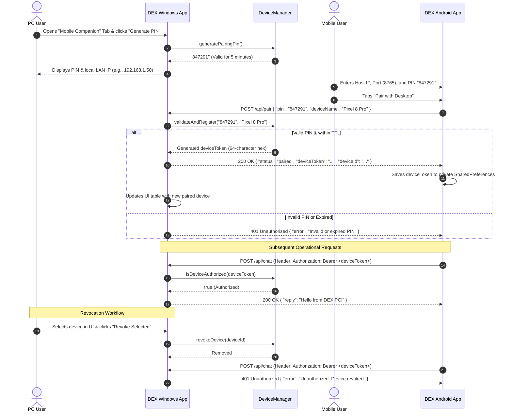

# DEX System Architecture & Security Specification

This document details the architecture, component topology, communications, and security model of **DEX** (Desktop Executive eXperience), a dual-platform system comprising a dedicated **Windows Desktop AI Assistant** and an **Android Mobile Companion**.

---

## 1. System Overview & Component Topology

```mermaid
graph TD
    subgraph Windows PC [Windows 10/11 Host Machine]
        subgraph DesktopUI [DEX Desktop Application]
            SwingUI["Java Swing UI (FlatLaf Dark Cyan HUD)"]
            Tray["System Tray Controller"]
            WinCtrl["Windows Automation Controller"]
            VoiceCtrl["Voice & Speech Controller"]
            VisionCtrl["Screen Vision Engine"]
        end

        subgraph CoreBackend [DEX Core Engine]
            ProvMgr["AI Provider Manager (Gemini, Claude, GPT, Groq, Ollama)"]
            MemMgr["Memory & Facts Engine (data/memory.json, facts.json)"]
            TaskMgr["Task & Audit Log Engine"]
            SecStore["SecretStorage (AES-256-GCM + PBKDF2)"]
            DevMgr["DeviceManager (PINs, Paired Tokens, Revocation)"]
        end

        subgraph WebServer [Embedded HTTP Server]
            Http["DEXWebServer (:8765)"]
            PairingEP["/api/pair & /api/pair/pin"]
            RestEP["/api/chat, /api/launch, /api/vision, /api/tasks"]
            WebDash["/ (Dashboard Web UI)"]
        end
    end

    subgraph MobileDevice [Android Companion Device]
        AndroidApp["DEX Mobile App (Android 8.0 - 14 / API 26-34)"]
        DexClient["DexClient (OkHttp3 REST Engine)"]
        SharedPrefs["Private App Storage (Device Token & Host IP)"]
        NoSecrets["ZERO AI API Keys / Pure Thin Client"]
    end

    %% Connections
    SwingUI --> CoreBackend
    Http --> CoreBackend
    SwingUI --> WinCtrl
    SwingUI --> VoiceCtrl
    SwingUI --> VisionCtrl
    
    AndroidApp --> DexClient
    DexClient --> SharedPrefs
    DexClient -.->|Authenticated HTTP/JSON (LAN/VPN)| Http
    
    ProvMgr -->|External TLS| CloudAI["Cloud AI Providers (Google, OpenAI, Anthropic)"]
    ProvMgr -->|Local Loopback| LocalAI["Local AI (Ollama :11434, FreeLLMAPI :31415)"]
```

---

## 2. Desktop Application Architecture

### 2.1 Core Subsystems
- **UI Subsystem (`com.dex.ui`)**:
  - Built on Java Swing with **FlatLaf Dark** customized with a cyber-cyan theme (`#00e5ff`, `#0a0e17`, `#111927`).
  - Divided into 8 functional panels: Chat & Reasoning, Task Audit & Cancellation, Windows Application Launchers, Browser Intelligence, AI Provider Configurations, Memory & Facts, Hardware & Process Diagnostics, and Mobile Companion Management.
- **AI Integration (`com.dex.ai`)**:
  - Modular provider abstraction (`AIProvider` interface) supporting direct streaming and JSON-based tool integration.
  - Providers: Google Gemini (`v1beta`), Anthropic Claude (`/v1/messages`), OpenAI GPT (`/v1/chat/completions`), Groq, OpenRouter, FreeLLMAPI, Ollama.
  - Automatic fallback mechanism: if primary provider encounters rate limits or network failures, requests gracefully reroute to a designated secondary provider.
- **Windows Automation (`com.dex.automation`)**:
  - `WindowsController`: Launch verified Windows applications (`notepad.exe`, `calculator:`, `chrome.exe`, `code.cmd`, `explorer.exe`, `ms-settings:`, `cmd.exe`, `powershell.exe`) with explicit allowlists and process tracking via `ProcessHandle`.
  - Path traversal and arbitrary command execution safeguards prevent untrusted shell invocations.
- **Screen Awareness & Voice (`com.dex.vision`, `com.dex.voice`)**:
  - `VisionController`: Safe screenshot capture using `java.awt.Robot` to `data/screenshots/` with immediate base64 payload packaging for multimodal models.
  - `VoiceController`: Hands-free speech input via Windows Voice Typing (`Win + H`) and speech synthesis through PowerShell `System.Speech.Synthesis`.

---

## 3. Mobile Companion Architecture

### 3.1 Design Principles
- **Zero Secret Exposure**: The mobile companion contains **zero** AI provider API keys, master credentials, or Windows administrator tokens. All LLM calls and automation occur through the Windows host backend.
- **Decoupled Lifecycle**: The Android companion can communicate with the Windows host whenever the DEX Web Server is running, regardless of whether the desktop GUI window is minimized, hidden to the system tray, or running headlessly.
- **Lightweight Native Android**:
  - Built using Android SDK (API level 26 to 34) with Material 3 styling.
  - Network operations managed by `OkHttp3` asynchronously on worker threads.
  - 4 functional tabs:
    1. **Chat**: Full conversation with DEX AI backend, streaming responses and conversation history.
    2. **Windows Remote**: One-click remote launch triggers for allowlisted Windows applications.
    3. **Vision AI**: Trigger remote desktop screenshots and submit AI vision queries to the Windows PC.
    4. **Settings & Pairing**: Real-time connection status, server IP/port configuration, PIN-based pairing, and token clearing.

---

## 4. Secure Communication & Device Pairing Protocol

To prevent unauthorized LAN devices or malware from invoking Windows desktop commands, DEX enforces a **two-phase pairing and authentication protocol**:



### 4.1 Key Security Properties of Pairing:
1. **Time-Limited PIN**: PINs are 6 cryptographically generated numeric digits, automatically expiring after 300 seconds (5 minutes). Single-use only; immediately consumed upon successful pairing.
2. **Cryptographic Tokens**: Each paired client receives an independent, 256-bit cryptographically secure hex token (`SecureRandom`).
3. **Instant Revocation**: The PC user has immediate, full visibility over all paired devices (device ID, name, paired timestamp, last used timestamp) and can revoke any device with one click.
4. **No Loopback Assumptions**: Mobile clients do not connect to `127.0.0.1`. The UI provides accurate LAN IP discovery (`com.dex.server.NetworkUtils`) for seamless home Wi-Fi or VPN connectivity.
5. **Information Masking**: Unauthenticated callers to `/api/status` receive only operational status (`status: "running"`); master remote tokens and system keys are never exposed without authorization.

---

## 5. Storage & Secret Security

| Resource | Storage Location | Protection Mechanism |
| :--- | :--- | :--- |
| **AI Provider API Keys** | `data/secrets.enc` | **AES-256-GCM** with PBKDF2-HMAC-SHA256 (65,536 iterations) key derivation using hardware/user salt (`data/.dex_salt`). Never stored in plaintext. |
| **Paired Devices** | `data/paired_devices.json` | Atomic write `.tmp` swap. Device tokens stored hashed/keyed in memory and verified per request. |
| **Conversations** | `data/memory.json` | Atomic write `.tmp` swap. Redacted before serialization; API keys regex-sanitized. |
| **User Facts & Context** | `data/facts.json` | Atomic write `.tmp` swap. Strictly local storage. |
| **Mobile Token** | Android SharedPreferences | App-private sandboxed XML storage (`MODE_PRIVATE`). Not exported or accessible across apps. |

---

## 6. Remote Network Access: LAN vs Remote VPN

1. **Local Network (LAN)**:
   - Suitable for home Wi-Fi environments.
   - DEX binds to `0.0.0.0:8765` when remote access is enabled by the user in settings.
   - All endpoints require either the master `remoteToken` or a valid paired `deviceToken`.
2. **Remote Access Outside LAN**:
   - Direct exposure of port 8765 to the public Internet via port forwarding is **strictly discouraged**.
   - **Recommended Approach**: Use a private encrypted mesh VPN such as **Tailscale** or **WireGuard**.
   - With Tailscale active on both the Windows host and Android companion, communication occurs across an encrypted WireGuard tunnel using private 100.x.y.z IP addresses with zero port forwarding required.
